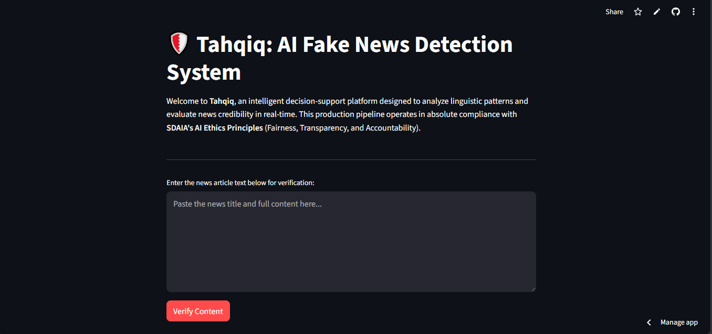
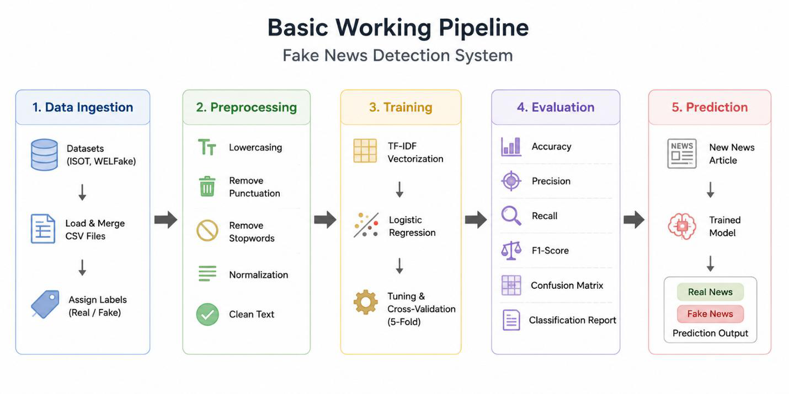
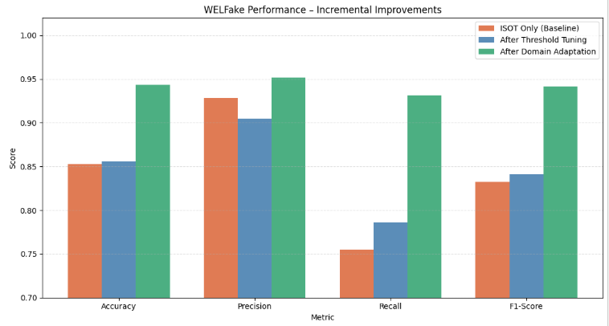

# 🛡️ Tahqiq: AI-Powered Fake News Detection

**Tahqiq** (تحقيق, *"verification"*) is an end-to-end machine learning system that classifies news articles as **Real** or **Fake**. A Streamlit interface shows the prediction together with a confidence score.

## Highlights

- **Full pipeline:**
  - Automated data download and cleaning
  - TF-IDF feature selection, comparing unigrams and bigrams
  - Hyperparameter tuning
  - Model packaging
- **Domain adaptation:** A model trained on a single dataset dropped to 85% accuracy on unseen data. Retraining across two datasets brought it back to **94%**.
- **Production-minded design:**
  - Automatic rollback to the baseline model if the production model fails to load
  - Inference logging
  - A load/stress-test script
- **CI pipeline:** GitHub Actions runs linting and unit tests on every push.

## Pipeline

1. **Data:** [ISOT Fake News](https://www.kaggle.com/datasets/emineyetm/fake-news-detection-datasets) for training. [WELFake](https://www.kaggle.com/datasets/saurabhshahane/fake-news-classification) for cross-domain evaluation and adaptation.
2. **Cleaning:** Lower-casing, removing URLs, and stripping source-agency "leakage" (e.g., *Reuters*) so the model can't cheat by recognizing the publisher.
3. **Features:** TF-IDF. Unigram and bigram configurations are compared with cross-validation, and the better one is selected automatically.
4. **Model:** Logistic Regression with tuned hyperparameters. It's fast, interpretable, and gives calibrated probabilities for the confidence score.
5. **Serving:** A Streamlit app with cached model loading and a fallback strategy.

## Results

| Stage | Accuracy | F1 |
|---|---|---|
| ISOT test set | **99.13%** | **99.20%** |
| WELFake: baseline model (no adaptation) | 85.26% | 83.27% |
| WELFake: after domain adaptation | **94.37%** | **94.14%** |

The near-perfect ISOT score doesn't carry over to a new source. Domain adaptation is what made the model hold up on unseen data.

## Responsible AI

The interface shows a confidence percentage and color-coded indicators. It also states clearly that Tahqiq is a **decision-support tool, not a final authority**, in line with SDAIA's AI ethics principles of fairness, transparency, and accountability.

## Tech stack

Python · scikit-learn · TF-IDF · Logistic Regression · Streamlit · pandas · joblib · GitHub Actions · pytest
